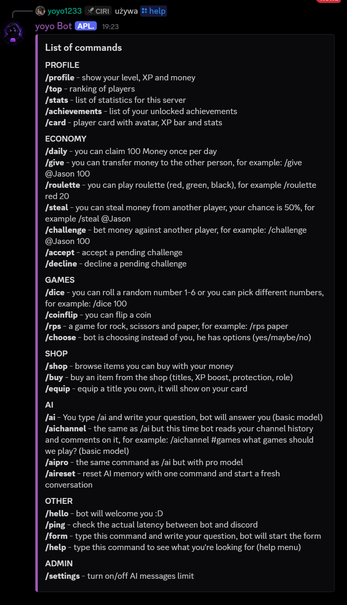

# Yoyo Bot

Discord bot with a leveling system, custom currency, games and AI integration.

## Features

- 📈 **Leveling system** - XP for every message, rewards on level up
- 💰 **Economy system** - Currency earned through activity and daily rewards, spent on games and transfers between players
- 🎮 **Games** - Dice, coinflip, rock-paper-scissors, roulette
- 🛒 **Shop** - Buy titles, XP boost, protection, roles
- 🤖 **AI** - DeepSeek, two models, conversation memory, channel context
- 🏆 **Achievements** - Three achievements to unlock

## Requirements
- Python 3.10+
- discord.py
- openai
- python-dotenv
- pillow

## Discord bot setup
1. Create an account on [Discord Developer Portal](https://discord.com/developers/home), then create a new application.

2. Go to the Bot tab, click reset token, save this token, you will need it later.

3. In the same Bot tab, scroll down to Privileged Gateway Intents and enable Message Content Intent. Without it the bot won't be able to read messages.

4. Next go to OAuth2 Tab, check the `bot` and `applications.commands` scopes, then below in Bot Permissions select:
   - Send Messages 
   - Send Messages in Threads 
   - Read Message History  
   - Add Reactions 
   - Manage Roles 

5. Copy the generated URL at the bottom of the page, open it in a new tab and add the bot to your server.

6. If you want to use AI, go to the [DeepSeek Platform](https://platform.deepseek.com). Create your API Key in the `API keys` tab, and later copy it to the `.env` file.

## Setup
1. Clone the repository:
```
git clone https://github.com/KubaZx/Yoyo-Bot.git
```
2. Install dependencies: 
```
pip install -r requirements.txt
```
3. Create a `.env` file and add your tokens:
```
DISCORD_TOKEN=your_token_here
DEEPSEEK_API_KEY=your_key_here
```
4. Run the bot:
```
python bot.py
```
The database is created automatically when you start the bot.

## Structure
- `bot.py` - entry point, event handlers, XP system, loads cogs
- `cogs/` - command modules: games, profile, economy, shop, AI, misc, settings
- `utils/` - database access, AI client and player card generation
- `schema.sql` - SQLite database schema

## Architecture decisions
- **SQLite instead of JSON**: JSON rewrote the whole file on every message. SQLite updates single rows, writes are transactional - a crash can't corrupt data. Queries like the `/top` ranking are a single `ORDER BY...LIMIT`. PostgreSQL would need a separate server, while SQLite is built into Python and is just one file.
- **Schema**: 5 tables (`players`, `inventory`, `achievements`, `ai_memory`, `guild_settings`). The primary key is `(user_id, guild_id)`, because one user can be on many servers. Lists are stored as one row per element.
- **Safe queries**: all values go through `?` placeholders, which prevents SQL injection.
- **Known limitation**: commands read, modify and write back player data, so two events for the same player at the same moment can lose one update. This could be fixed with atomic queries like `UPDATE...SET money = money + ?`.

## Commands
### Profile
| Command         | Description                               |
|-----------------|-------------------------------------------|
| `/profile`      | show your level, XP and money             |
| `/top`          | ranking of players                        |
| `/stats`        | list of statistics for this server        |
| `/achievements` | list of your unlocked achievements        |
| `/card`         | player card with avatar, XP bar and stats |

### Economy
| Command | Description                                                               |
|---------|---------------------------------------------------------------------------|
| `/daily`| you can claim 100 Money once per day                                      |
| `/give` | you can transfer money to the other person, for example: /give @Jason 100 |
| `/roulette` | you can play roulette (red, green, black), for example /roulette red 20|
| `/steal` |  you can steal money from another player, your chance is 50%, for example /steal @Jason|
| `/challenge` | bet money against another player, for example: /challenge @Jason 100|
| `/accept` | accept a pending challenge|
| `/decline` | decline a pending challenge|

### Games
| Command | Description|
|---------|------------|
| `/dice` | you can roll a random number 1-6 or you can pick different numbers, for example: /dice 100|
| `/coinflip` | you can flip a coin|
| `/rps` | a game for rock, scissors and paper, for example: /rps paper|
| `/choose` |  bot is choosing instead of you, it has options (yes/maybe/no)|

### Shop
| Command  | Description                                                    |
|----------|----------------------------------------------------------------|
| `/shop`  | browse items you can buy with your money                       |
| `/buy`   | buy an item from the shop (titles, XP boost, protection, role) |
| `/equip` | equip a title you own, it will show on your card               |

### AI
| Command      | Description                                                                                                                                              |
|--------------|----------------------------------------------------------------------------------------------------------------------------------------------------------|
| `/ai`        | you type /ai and write your question, bot will answer you (basic model)                                                                                  |
| `/aichannel` | the same as /ai but this time bot reads your channel history and comments on it, for example: /aichannel #games what games should we play? (basic model) |
| `/aipro`     | the same command as /ai but with pro model                                                                                                               |
| `/aireset`   | reset AI memory with one command and start a fresh conversation                                                                                          |

### Other
| Command | Description|
|---------|------------|
| `/hello` | bot will welcome you :D|
| `/ping` | check the actual latency between bot and Discord|
| `/form` | type this command and write your question, bot will start the form|
| `/help` | type this command to see what you're looking for (help menu)|

### Admin
| Command | Description                   |
|---------|-------------------------------|
|`/settings` | turn on/off AI messages limit |

## Preview


## Roadmap

- ✅ Split the bot into modules
- ✅ Move from JSON to SQLite database
- ✅ Slash commands
- ✅ Add requirements.txt
- ✅ Replace print() with proper logging
- ✅ Player card with Pillow
- ✅ Shop with roles, titles and double XP boosts
- ✅ Rate limit for AI commands
- ⬜ Dockerfile
- ⬜ Deploy the bot for 24/7 uptime
- ⬜ Add unit tests for economy logic
- ⬜ Function calling/tool use for AI

## License
This project is licensed under the MIT License, see the [LICENSE](LICENSE) file for details.
